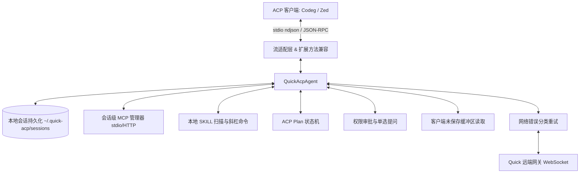

# Quick-acp 能力对标补齐设计与执行记录

**基准版本**: v0.1.5（已发布至 npm 官方仓库，哈希一致验证）
**执行原则**: 真实可实现的彻底实现并编写离线回归测试；协议/上游真正不支持的给出代码与规范确凿证据，不虚报能力，不把未实现假称不支持；严格适配当前依赖 `@zed-industries/agent-client-protocol` 0.4.5。

---

## 一、ACP 协议规范（SDK 0.4.5）与上游网关能力核对

通过对 `node_modules/@zed-industries/agent-client-protocol`（版本 0.4.5）源码与类型定义的审查：

### 1. 会话生命周期协议证据
- **标准方法**：`schema.AGENT_METHODS` 包含：
  `authenticate`, `initialize`, `session/cancel`, `session/load`, `session/new`, `session/prompt`, `session/set_mode`, `session/set_model`。
- **扩展方法机制**：SDK 0.4.5 的 `AgentSideConnection` 在处理非标准方法时规定：
  若方法以 `_` 开头，截取后分发给 `agent.extMethod(method.substring(1), params)`；否则抛出 `methodNotFound`。
  因此，对于 `session/list`, `session/resume`, `session/fork`：
  - 属于 ACP 生态扩展规范（Codeg / Zed 社区扩展草案）；
  - 我们在入站流建立标准化前缀适配器，对 `session/list` 等请求自动适配并分发到 `extMethod`，同时实现标准 `loadSession` 供官方标准调用。
- **Quick 上游网关特性**：
  Quick 网关采用服务端持有的 `thread_id`。每个新会话为一个新 UUID，服务端不提供查询/重演所有历史消息的 HTTP API，亦不提供服务端分支（fork）。
  因此：
  - 建立**本地会话存储**（`~/.quick-acp/sessions/{sessionId}.json`），记录完整对话轮次与工具卡片结果；
  - `session/load` 重放本地完整事件序列，建立与 Quick 网关的新/旧 thread 绑定；
  - `session/fork` 为**会话级分叉**：复制父会话当前全部历史 turns，派生新 thread 并在首轮以历史摘要恢复上下文。**协议边界明确：不支持在对话树任意历史 turn 节点任意回退分叉**。

### 2. MCP 挂载协议证据
- ACP 0.4.5 明确定义了 `McpServer` 联合类型：
  - `Stdio`: `{ command: string; args: string[]; env: EnvVariable[]; name: string }`
  - `Http`: `{ type: "http"; url: string; headers: HttpHeader[]; name: string }`
  - `Sse`: `{ type: "sse"; url: string; headers: HttpHeader[]; name: string }`
- 架构解法：在 Quick-acp 本地进程建立会话级 MCP 管理器，当客户端在 `session/new` 或 `session/load` 传入 `mcpServers` 时：
  - 本地直连 stdio 子进程或发起 HTTP/JSON-RPC 通信；
  - 工具名称自动加命名空间前缀：`mcp__s${cleanServerName}__${toolName}`，避免命名冲突；
  - **生命周期清晰隔离**：单轮对话取消 (`session/cancel`) 仅中断当前轮次执行，**绝不关闭 MCP 服务**；仅在会话彻底销毁（客户端断开、进程退出、重新 load 覆盖）时清理 stdio 子进程树或发送 HTTP DELETE 请求。

### 3. 计划 (Plan)、斜杠命令与本地 SKILL 读取证据
- **ACP Plan**：`sessionUpdate: 'plan'` 属于 SDK 0.4.5 原生支持的 8 种 `sessionUpdate` 之一，包含 `entries: [{ content, priority, status }]`。
- **Available Commands**：`sessionUpdate: 'available_commands_update'` 原生支持，客户端收到后展现斜杠命令补全菜单。
- **本地 SKILL**：扫描工作区与用户目录（`.gemini/skills`, `.agents/skills`, `skills/`），读取 `SKILL.md`，注入到可用命令列表；当用户输入对应命令时，提取技能正文并注入模型提示词。

### 4. 工具权限审批与用户提问证据
- **`session/request_permission`**：SDK 0.4.5 客户端标准方法。
  - 支持向用户弹窗审批敏感操作（如写文件、执行 Shell）；
  - 兼顾 Headless/CI 环境：支持自动放行模式与 fail-closed 拒执行守卫；
  - 审批被拒绝后，立即中止工具调用，返回拒绝信息，不产生副作用。
- **`ask_user_question`**：
  - 通过将结构化问题映射为 ACP `requestPermission` 的单选项列表（`kind: 'allow_once'`），实现模型主动向用户单选提问。
  - **能力边界**：当前 ACP SDK 0.4.5 仅支持单选按钮，**不支持多选框或自由文本表单**。

### 5. 用量更新 (usage_update) 与未保存缓冲区读取 (fs/read_text_file)
- **协议真实证据**：
  在 `@zed-industries/agent-client-protocol` 0.4.5 中，`sessionUpdate` 的 Zod 联合类型严格限定为 8 种，**不存在 `usage_update`**。若强行发送未定义的 `sessionUpdate: 'usage_update'`，标准客户端的 Zod 校验将直接报错崩溃。
  - 正确兼容做法：用量通过 `PromptResponse._meta.usage` 返回，并通过扩展通知 `session/usage` 发送；同时在思考/日志中展示。
- **未保存缓冲区读取**：
  客户端在 `initialize` 握手声明 `clientCapabilities.fs.readTextFile: true` 时，代理在执行 `file_read` 时优先调用客户端 `fs/read_text_file` 获取编辑器未保存的脏缓冲区；若客户端失败或未打开，平滑回退到磁盘文件系统。

### 6. 网络错误分类重试证据
- Quick 网关基于 WebSocket 长连接与云端模型调用，常见偶发网络抖动（ECONNRESET、ETIMEDOUT、502、503、429）。
- **重试安全边界**：
  - 只有在模型生成阶段、尚未执行任何产生副作用的工具（如写文件、执行 Shell）时，才允许安全重试；
  - 一旦工具已经执行成功，或已向客户端流式输出了部分正文，坚决不重放该轮次；
  - 用户发起 `session/cancel` 时，重试定时器与网络请求立即中止，绝不挂起。

---

## 二、六大模块架构实现

1. `src/session/persistence.ts`：本地会话持久化引擎，支持 list, load, resume, fork，保证跨进程会话留存。
2. `src/mcp/manager.ts`：会话级 MCP 管理器，处理 stdio 与 HTTP 传输，工具命名空间隔离，会话销毁时清理。
3. `src/features/plan.ts`：计划任务工具与 ACP `plan` 状态推送。
4. `src/features/skills.ts`：本地 SKILL.md 发现与斜杠命令目录生成，支持按需技能注入。
5. `src/features/permission.ts`：ACP 权限门禁与单选提问桥接，支持无头/自动化回退。
6. `src/features/retry.ts`：网络错误分类重试与安全边界守卫。
7. `src/features/fs-delegate.ts`：未保存编辑器缓冲区委托读取与磁盘回退。

---

## 三、离线回归与全流程验证记录

- **全部 19 项全套核心与进阶能力离线回归**（`npm run test:regression`）：
  - 1. 首轮图片附件转发守卫；
  - 2. 文件内容含 Markdown 代码块解析守卫；
  - 3. 4 反引号代码块容错解析；
  - 4. 多工具格式（数组与多块）解析；
  - 5. 流式输出过滤（防 JSON 泄露）；
  - 6. 工具伴随文字正文正常保留；
  - 7. 工具参数别名容错（file/cmd/text）；
  - 8. 工具执行中止/取消机制；
  - 9. robustJsonParse 字符串内部逗号保护；
  - 10. parseToolCalls 防嵌套工具示例误执行；
  - 11. 执行中取消及任意分片边界守卫；
  - 12. 本地会话持久化 (原子写/0600/ID校验/历史完整性/fork独立线程)；
  - 13. 会话 MCP stdio 与 HTTP/SSE 挂载与清理；
  - 14. 计划工具 (plan_update) 与结构化状态机；
  - 15. 本地 SKILL 读取、内置命令本地拦截与 skill_read 工具；
  - 16. 工具权限审批 fail-closed、MCP纳入授权与单选提问；
  - 17. 未保存缓冲区有界读取与磁盘平滑回退；
  - 18. 网络错误重试守卫 (流式防重正文/副作用防护)；
  - 19. 并发同 session prompt 互斥保护 (-32600) 与 closeAll 清理。
- **离线 ACP stdio 全流程集成测试**（`npm run test:integration`）：
  - 10 步自动化闭环测试（初始化、计划更新、斜杠命令、持久化保存、会话恢复、会话分叉、技能读取、缓冲区委托、单选提问）。
